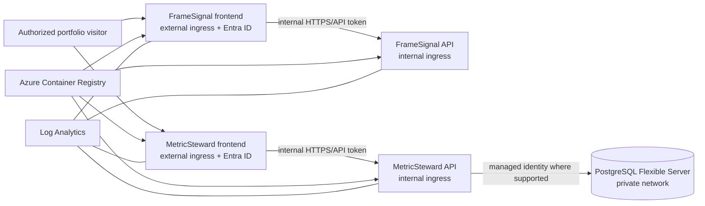

# Superseded Azure Draft

**Do not use this draft.** The active plan is [Railway deployment plan](../docs/railway-deployment-plan.md). Azure was not selected and no Azure resources were created. The remaining text below is retained only as planning history.

## Goal and Boundaries

Deploy FrameSignal Lab and MetricSteward as an authenticated educational portfolio demo. The application remains synthetic and educational; deployment does not imply production suitability, independent review, or metric approval. Preserve existing scientific results and MetricSteward review provenance.

The design uses Azure Container Apps, Azure Container Registry, Azure Database for PostgreSQL Flexible Server, and Bicep. The first deployment will use ACA-generated URLs, preserve the existing MetricSteward catalog/review history, and create a new resource group. Subscription, region, budget, Entra tenant, and authorized user/group are not yet selected. Do not provision until those are confirmed.

## Current Progress

- Both nginx frontends now accept runtime-configured API upstreams while retaining their Docker Compose service names as local defaults.
- Both frontend images rebuilt successfully, and both proxied API health endpoints returned `status: ok`.
- Authentication, PostgreSQL migration, Bicep, and Azure resources have not been implemented or provisioned.

## Proposed Topology

Deploy four separate container apps to preserve the existing service boundaries. Only the two frontend apps receive external ingress. Their nginx containers proxy same-origin API requests to the internal APIs by ACA service DNS. Both APIs additionally validate Microsoft Entra access tokens; an internal network boundary alone is not authentication.

## Prerequisites Before Provisioning

- Select Azure subscription, region, environment name, and a monthly cost ceiling. Create a new resource group after the target is chosen. Confirm permission to create the required resources and Entra app registrations.
- Establish the Entra tenant and authorized user/group. Use ACA-generated URLs for the first environment; a custom domain can be added later.
- Migrate the current MetricSteward catalog and review history; preserve existing records rather than starting with an empty catalog.
- Choose data retention, backup retention, and who can export the educational catalog.
- Confirm that only synthetic data and non-sensitive reviewer information will be stored.

## Implementation Stages

1. **Make service routing configurable.** Replace Compose-only nginx upstreams with startup-time templates or equivalent runtime configuration. Set FrameSignal and MetricSteward internal API FQDNs through Container App environment variables. Keep local Compose defaults working. Preserve same-origin `/api/` routing and do not expose API ingress publicly.
2. **Add Entra authentication.** Register the SPA clients and API audience/scopes. Require login in both frontends and send access tokens on API requests. Add backend token validation for issuer, audience, signature, expiry, and required scope/role. Reject anonymous reads and writes unless a deliberate public-read policy is reviewed separately. Keep the existing block on real-world approval unchanged. Do not trust caller-supplied identity headers unless they are set by a verified auth component and stripped from untrusted requests.
3. **Move the catalog to PostgreSQL.** Introduce a database adapter and schema migrations while retaining SQLite for local development/tests. Preserve append-only review semantics, foreign keys, import idempotency, timestamps, and educational-status constraints. Use managed identity/Entra database authentication if supported by the selected configuration; otherwise store credentials in Key Vault and reference them from the Container App. Do not use a shared SQLite file as the cloud multi-replica database.
4. **Preserve and migrate existing data.** Export the current catalog and reviews, record row counts and checksums, migrate to PostgreSQL, and compare imports, metrics, and review histories. Keep a restricted backup and documented rollback path until post-migration verification passes. Do not create or imply new peer-review records.
5. **Add Bicep infrastructure.** Define the Container Apps environment, four apps and ingress settings, ACR, PostgreSQL, managed identities/RBAC, Key Vault only if required, networking for private database access, Log Analytics, and health probes. Use non-secret parameters and avoid embedding subscription-specific identifiers or credentials in the repository.
6. **Build and release images.** Build from the repository root using the existing Dockerfiles after the runtime-routing changes. Push immutable commit-tagged images to ACR using GitHub Actions OIDC/workload identity federation; avoid registry passwords and long-lived Azure credentials. Deploy first to a non-production environment.
7. **Validate and promote.** Verify Entra sign-in and denial paths, API token enforcement, private API ingress, both frontends, health checks, metric-library parity, evidence import/export, and preserved catalog/review counts. Check logs for secrets or personal data. Promote only after the acceptance criteria below pass.

## Acceptance and Rollback

- Anonymous visitors cannot access protected frontends or call either API; authorized users can use intended workflows.
- Backend APIs have no public ingress. Frontend API proxying works over ACA internal networking.
- MetricSteward catalog and review records survive app restart and deployment, and verified migration counts/checksums match.
- Existing scientific classifications, real-world approval blocks, and self-review/provenance semantics remain unchanged.
- Health probes are green; both applications work on desktop and mobile; no credentials appear in image layers, source, or logs.
- CI tests, backend type/lint checks, frontend builds, and targeted deployment smoke tests pass before promotion.

Rollback by redeploying the previous immutable image set and, if a database migration is implicated, restoring the verified pre-migration backup using a rehearsed procedure. Do not drop or rewrite the source SQLite volume during migration.

## Next Gate

The next step is to select a subscription, region, and monthly cost ceiling, then establish the Entra tenant/app registrations and authorized user/group. The resource group will be new, ACA-generated URLs will be used, and catalog migration is required. Provisioning requires a separate explicit confirmation.